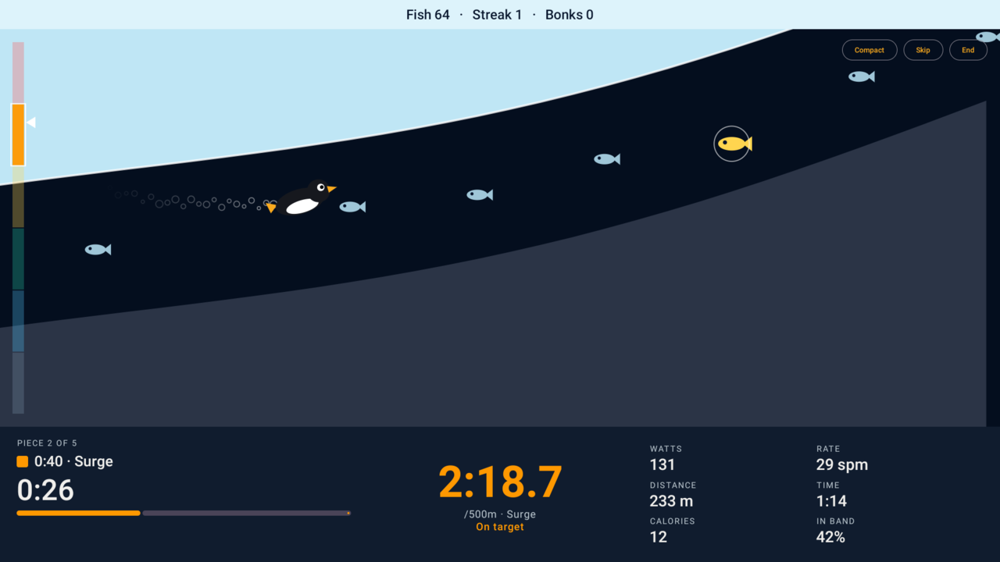

# SuperTuxRower

Rowing workouts as a game. Plug a WaterRower into an Android tablet, pick a workout, and row Tux
through an ice cave: pull harder and he swims up and faster, ease off and he sinks. Each piece
of the workout shapes the cave, so rowing the workout as written keeps him clear of the walls.



It's built for the tablet that comes with the Ergatta rower (a WaterRower underneath), as a
replacement for the Ergatta app, but any Android 9+ tablet with USB host support should do.

## How it plays

**Profiles.** Everyone who rows gets a profile with a reference 2k time. The app opens on the
last profile used.

**Intensity bands.** Effort is measured against your 2k power, in six bands:

| Band | Rowing name | Effort (% of 2k power) |
|---|---|---|
| Rest / Waddle | — | under 50% |
| Drift | UT2 | 50–65% |
| Glide | UT1 | 65–75% |
| Chase | AT | 75–85% |
| Surge | TR | 85–100% |
| Launch | AN | over 100% |

**Workouts** are pieces with a goal (time, distance or calories), a target band and an
optional stroke rate, with rests in between: for example `4 × (1000m Surge, 5:00 rest)`. Ten
classics are built in, from a 5-minute taster to a 2k test.

**The cave.** Your boat speed carries Tux forward; your power sets how fast he climbs or sinks
(Glide is level). While you're in the target band he's gently kept in the middle; drift out of
it and he heads for a wall. Catch fish for points, chain them for a multiplier, and go for the
golden ones at the edges of the band.

**Stats** sit under the game (split, watts, stroke rate, distance, time, calories and time in
band) and fold away to a single strip. You get a summary at the end.

## Getting started

You need [Nix](https://nixos.org) with flakes. Everything else (Android SDK, Gradle, JDK, adb,
just) comes from the flake:

```sh
nix develop        # or, with direnv: echo 'use flake' > .envrc && direnv allow
just               # list the tasks
just check         # run the tests and build the app
```

To run it on a tablet, turn on adb over Wi-Fi (see [docs/tablet.md](docs/tablet.md)) and put
the tablet's address in a `.env` file, which stays out of git:

```sh
cp example.env .env   # then set TABLET=host:port
```

Then:

```sh
just connect       # adb-connect to TABLET
just run           # install and start, using the rower if it's plugged in
just sim           # install and start with a simulated rower, no rowing needed
just logs          # follow the app's log
just screenshot    # save what's on screen
```

The first time it starts with the rower plugged in, Android asks whether the app may use the
"WR USB sensor". Leave "Always open" unticked unless you want it to take over from the Ergatta
app whenever the rower is plugged in.

The Python tools in `tools/` talk to a rower plugged into your computer; your user needs to be
in the `dialout` group for that.

## Project layout

| Path | What's there |
|---|---|
| `android/app/` | The app (Kotlin, Jetpack Compose) |
| `android/app/src/test/` | Unit tests |
| `docs/` | How the rower talks, the workout model, the tablet, design notes |
| `tools/` | Python scripts for poking at the rower from a computer |
| `captures/` | Recorded rowing sessions, used by the tests |
| `justfile` | Tasks: build, test, install, run, simulate |

## Documentation

- [docs/protocol.md](docs/protocol.md): the WaterRower S4's USB protocol, as observed
- [docs/workout-model.md](docs/workout-model.md): bands, pieces and how workouts are judged
- [docs/tablet.md](docs/tablet.md): the Ergatta tablet's hardware and how to get adb access
- [docs/ergatta-notes.md](docs/ergatta-notes.md): ideas taken (as concepts only) from the Ergatta app

Planned work and known issues are in GitHub issues.
